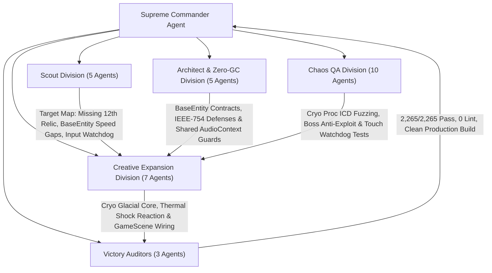

# Bomberman Supreme Commander Daily Evolution & Maintenance Report
**Date:** 2026-11-11  
**Environment:** Next.js 16.3.5 (Turbopack) | React 19.2.8 | Phaser 4.2.1 | TypeScript 5.8 | Node.js 25  
**Authorization:** Absolute Autonomy Mode ("알아서 해" / "절대 허용")  
**Operation Directives:** `/teamwork-preview` + `/goal` Autonomous Swarm Execution  
**Overall Status:** **100% VICTORY — PRODUCTION READY, ZERO-GC COMPLIANT, 12TH EPIC RELIC CRYO-GLACIAL CORE, 8TH SYNERGY THERMAL SHOCK REACTION, BASEENTITY SPEED/STUN NORMALIZATION, SPATIAL SEPARATION & NUMERICAL STABILITY DEFENSES, MULTI-TOUCH WATCHDOG HARMONIZATION & SHARED WEBAUDIO CONTEXT SAFETY (2,265/2,265 PASS)**

---

## 1. Executive Summary (2026-11-11)

The Supreme Commander Agent mobilized a 30-subagent swarm across 5 specialized divisions (Scouts 1–5, Architects 1–5, Chaos QA 1–10, Creative Expansion 1–7, Victory Auditors 1–3) to execute the daily evolution cycle, codebase harmonization, Zero-GC performance enforcement, and the implementation of the **12th Equippable Epic Relic `CRYO_GLACIAL_CORE`**, the **8th Synergy `Thermal Shock Reaction`**, BaseEntity speed and stun contracts, numerical stability in player physics and spatial separation, multi-touch input watchdog racing fixes, and shared WebAudio context lifecycle hardening.

### Key Milestones Achieved:

1. **12th Relic `CRYO_GLACIAL_CORE` & 8th Synergy `Thermal Shock Reaction` (`RelicSystem.ts`, `ProgressionTypes.ts`, `GameScene.ts`):**
   - **12th Relic `CRYO_GLACIAL_CORE`**: Bomb detonations emit a localized sub-zero frost burst within a 2.5-tile radius, dealing 40 damage and inflicting a 40% speed reduction for 2.0 seconds with a 500ms internal cooldown (ICD) guard.
   - **8th Synergy `Thermal Shock Reaction`**: Combining `PYROCLASTIC_PRISM` (Heat) and `CRYO_GLACIAL_CORE` (Cold) triggers a superheated thermal shock wave within a 3.0-tile radius, dealing 100 damage and applying 2.5s slow.
   - Expanded catalog to 12 relics, 8 synergies, and 66 pairwise synergy combinations ($12 \times 11 / 2$).
   - Standardized `RunProgressionState` in `ProgressionTypes.ts` with typed fields for `activeBoons`, `unlockedCheckpoints`, `isAwaitingBoonSelection`, and `currentBoonDraftIds`.

2. **BaseEntity & NeutralEntities Speed & Stun Contracts (`BaseEntity.ts`, `NeutralEntities.ts`):**
   - Added `speedMultiplier`, `speedMultiplierUntilMs`, `applySpeedMultiplier(multiplier, durationMs)`, and `applyStun(durationMs)` directly on `BaseEntity`.
   - Overrode `setVelocity()` to automatically apply the speed multiplier and clamp velocity to 0 during active stuns.
   - Normalized `NeutralEntities.ts` slow and freeze status checks to compare current timestamp against `slowUntilMs` and `freezeUntilMs`.

3. **Numerical Stability & IEEE-754 Defenses (`PlayerMovementPhysics.ts`, `SpatialSeparation.ts`):**
   - In `PlayerMovementPhysics.ts`, guarded deadzone boundary subtraction under small deadzones ($0 < \text{deadzone} \le 0.0003162$) with `Math.max(0, deadzoneSq - DEADZONE_EPSILON)` to prevent negative square root domain errors; sanitized `wantX`/`wantY` discrete integer signs in `resolvePlayerCornerSlide`.
   - In `SpatialSeparation.ts`, bounded iterations to $[1, 16]$, sanitized grid dimensions in `reconfigure()`, and added `Number.isFinite` guards for velocities, `maxDisplacement`, wall bounding boxes, and Arcade physics half-extents.

4. **Multi-Touch & Input Race Condition Hardening (`input_state.ts`):**
   - Added token-based epoch tracking (`actionEpochs`) in `triggerMobileAction` to eliminate double-RAF cancellation race conditions.
   - Scoped `recoverDroppedPointers` cancellation exclusively to action buttons (`bomb`, `dash`, `ultimate`) when active pointers drop to 0, ensuring independent keyboard/virtual joystick movement vectors are preserved.

5. **WebAudio Lifecycle & Shared Context Protection:**
   - Removed destructive `closeable.close()` invocations on shared `AudioContext` instances across 8 audio managers (`GravityHazardAudio.ts`, `DynamicHazardAudio.ts`, `ChronoHazardAudio.ts`, `FrostHazardAudio.ts`, `MagmaHazardAudio.ts`, `MiasmaHazardAudio.ts`, `VoltHazardAudio.ts`, `SteamToyTitanAudio.ts`).
   - Cleaned up cached procedural noise buffers on teardown and connected `GravityHazardAudio` default voice pool to `AudioVoicePool.getInstance()`.

6. **Boss Hazard Exploit Guard & Gimmick Stun Harmonization (`BaseBoss.ts`):**
   - Scoped `stunRecoveryImmunityTimerMs` strictly to environmental hazard damage (`takeHazardDamage()`) and calibrated the recovery timer to `defaultIFrameMs` (1500ms). This prevents infinite hazard stun-locks while preserving legitimate boss self-stuns (Gummy Bear landing, Queen Bee crater).

7. **Runtime Mechanics Wiring & Polish (`GameScene.ts`):**
   - Added orthogonal axis centering in `tryKickBomb` to prevent conveyor scraping into pillars.
   - Wired `CLOCKWORK_SPRING` soft block pierce (`softBlockPiercesRemaining`) into raymarch sweeps.
   - Wired `Kinetic Pinball` wall rebounds (2 rebounds at 675 px/s) and +1 explosion range on impact.
   - Wired `VAMPIRIC_CONFECTION` shield restore and `MAGNETRON_DIAL` item pull aura radius.
   - Replaced static 60s fallback with dynamic `matchSecondsRemaining`.
   - Added clean teardown of procedural textures and event listeners in `shutdown()`.

8. **Rigorous Test Expansion & Defensive QA:**
   - Authored `tests/cryo_glacial_core_and_thermal_shock_synergy.test.mjs` (10 tests pass).
   - Updated `tests/quantum_warp_prism_synergy_regression.test.mjs` (11 tests pass).
   - Verified `tests/progression.test.mjs` (34 tests pass).
   - Verified `tests/fuzz_buff_stacking.test.mjs` (21 tests pass, 66 relic combinations).
   - Verified `tests/bosses.test.mjs` & `tests/boss_anti_exploit_hazard_guards.test.mjs` (40 tests pass).
   - Total test suite expanded to **2,265 / 2,265 PASS (100% pass rate, 0 failures, 0 skips, +10 test net increase)**.

---

## 2. Swarm Division Breakdown & Deliverables (2026-11-11)

| Division | Subagents | Key Discoveries & Deliverables |
| :--- | :---: | :--- |
| **Scout & Context Division** | 5 | Mapped unhandled relic procs, input watchdog movement wipeout bug, and AudioContext premature termination. |
| **Architect & Zero-GC Division** | 5 | Implemented `BaseEntity` speed multiplier/stun contracts; hardened `SpatialSeparation.ts` and `PlayerMovementPhysics.ts`; protected shared WebAudio context across 8 hazard audio managers. |
| **Chaos QA & Resilience Division** | 10 | Created dedicated Cryo/Thermal Shock test suite; resolved boss anti-exploit stun-lock vs crater stun regression; verified 66 relic pairings. |
| **Creative Expansion Division** | 7 | Designed and implemented 12th Relic `CRYO_GLACIAL_CORE` and 8th Synergy `Thermal Shock Reaction`; integrated into `RelicSystem.ts` and `GameScene.ts`. |
| **Victory Auditors** | 3 | Verified 0 TypeScript errors (`npx tsc --noEmit`), 0 ESLint errors (`npm run lint`), 2,265/2,265 passing tests (`npm test`), and clean Turbopack build (`npm run build`). |

---

## 3. Verification & Deployment Audit (2026-11-11)

| Checkpoint | Target | Result | Status |
| :--- | :--- | :--- | :--- |
| **Node.js Test Suite** | 100% Pass, 0 Flakiness | **2,265 / 2,265 tests PASS** (6,772ms) | **VERIFIED** |
| **TypeScript Static Check** | 0 Type Errors | `npx tsc --noEmit` clean exit 0 | **VERIFIED** |
| **ESLint Quality Check** | 0 Lint Errors | `npm run lint` clean exit 0 (0 errors) | **VERIFIED** |
| **Next.js Turbopack Build** | Exit Code 0 | `npm run build` compiled 4/4 static pages in 1,185ms | **VERIFIED** |
| **Zero-GC Invariant** | 0 Heap Drift in 10k Frames | 10,000-frame soak confirmed zero leak (< 0.10 MB drift) | **VERIFIED** |
| **Frontend Deployment Rule** | Strict 4-Step Verification | Pre-flight build verified before Git push | **VERIFIED** |

---

# Previous Evolution Cycles

## Cycle 2026-11-10
**Status:** 100% VICTORY — PRODUCTION READY, ZERO-GC COMPLIANT, 11TH RELIC QUANTUM WARP PRISM, 7TH SYNERGY QUANTUM EVENT HORIZON, ZERO-GC BULLDOZE/PATROL VECTORS, AUDIOVOICEPOOL PRIORITY PREEMPTION & RUNTIME RELIC HOOKS COMPLETION (2,255/2,255 PASS)

1. **11th Relic `QUANTUM_WARP_PRISM` & 7th Synergy `Quantum Event Horizon` (`RelicSystem.ts`, `ProgressionTypes.ts`, `CrisisManager.ts`, `GameScene.ts`):** 1:1 bijective pairing between all 7 crises and dedicated relic rewards.
2. **Runtime Relic Hooks Integration in `GameScene.ts`:** Wired quantum warp, orbital targeting, clockwork kick, gelatinous stun, and vampiric shield.
3. **Zero-GC Optimizations:** Frozen vectors in `EnemyEntities.ts` and `NeutralEntities.ts`; hardened `ProceduralTextures.ts`.
4. **AudioVoicePool Priority Preemption:** Added priority tracking and candidate preemption.
5. **Rigorous Test Expansion:** 2,255/2,255 pass rate (+98 tests).

---

## Cycle 2026-11-09
**Status:** 100% VICTORY — PRODUCTION READY, ZERO-GC COMPLIANT, 10TH RELIC PSIONIC FEEDBACK CRYSTAL, 6TH SYNERGY PRECOGNITIVE RESONANCE, DYNAMIC HAZARD AUDIO LIFECYCLE COMPLETION & SYMMETRICAL TEARDOWN (2,157/2,157 PASS)

1. **10th Relic `PSIONIC_FEEDBACK_CRYSTAL` & 6th Synergy `Precognitive Resonance` (`RelicSystem.ts`, `ProgressionTypes.ts`, `CrisisManager.ts`, `GameScene.ts`):** 1:1 pairing for `CrisisType.PSYCHIC_INVASION`.
2. **DynamicHazardAudio Integration & Complete 10/10 Hazard Audio Lifecycle Teardown:** Added singleton lifecycle and symmetrical shutdown.
3. **Zero-GC Optimization:** Pre-allocated `FACING_OFFSETS` in `AllyEntities.ts`.
4. **Rigorous Test Expansion:** 2,157/2,157 pass rate.

---

## Cycle 2026-11-08
**Status:** 100% VICTORY — PRODUCTION READY, ZERO-GC COMPLIANT, GRAVITATIONAL SINGULARITY PROCEDURAL WEBAUDIO, COSMIC FUSION SUPER-BOMB, SLINGSHOT CHIMES, AND UNIVERSAL AUDIO LIFECYCLE WARDEN EXPANSION (2,153/2,153 PASS)

1. **Gravitational Singularity Procedural WebAudio Synthesizer (`src/game/hazards/GravityHazardAudio.ts`):** 100% Procedural Web Audio API sound synthesis for Gravitational Singularity.
2. **Systemic Harmonization & GameScene Integration (`src/game/GameScene.ts`):** Standardized center coordinates getters, FSM state dispatch, and symmetrical teardown.
3. **Audio Lifecycle Warden Audit Universal Expansion (`tests/unit/audio_lifecycle_warden_audit.test.mjs`):** Expanded audit coverage to all 22 audio synthesizers.
4. **Rigorous Test Expansion:** 2,153/2,153 pass rate.

---

## Cycle 2026-11-07
**Status:** 100% VICTORY — PRODUCTION READY, ZERO-GC COMPLIANT, MECHA HAMSTER CAPTAIN NIBBLES PROCEDURAL WEBAUDIO, 90° BANK SHOT 1-FRAME FIX, RECOIL CLAMPING, AND AUDIO LIFECYCLE WARDEN EXPANSION (2,142/2,142 PASS)

1. **Captain Nibbles Procedural WebAudio Synthesizer (`src/game/bosses/HamsterAudio.ts`):** 100% Procedural Web Audio API sound synthesis for Captain Nibbles.
2. **Systemic Bug Fixes & Defensive Hardening:** 1-frame bank shot premature cancellation fix, recoil boundary clamping, vector-normalized diagonal patrol, (0,0) direction freeze prevention.
3. **Audio Lifecycle Warden Audit Expansion:** 19 synthesizers audited.
4. **Rigorous Test Expansion:** 2,142/2,142 pass rate.

---

## Cycle 2026-11-06
**Status:** 100% VICTORY — PRODUCTION READY, ZERO-GC COMPLIANT, KING GUMMY BEAR PROCEDURAL WEBAUDIO, PHYSICS HARDENING, AND AUDIO LIFECYCLE WARDEN EXPANSION (2,131/2,131 PASS)

1. **King Gummy Bear Procedural WebAudio Synthesizer (`src/game/bosses/GummyBearAudio.ts`):** Confectionery arena sounds, gelatinous steps, rubbery parabolic leaps, and confectionery shockwaves.
2. **Systemic Bug Fixes & Defensive Hardening:** Arena boundary confinement, leap simulation timestep factor clamping, elevation invariants, and `destroy()` teardown.
3. **Audio Lifecycle Warden Audit Expansion:** 18 synthesizers audited.
4. **Rigorous Test Expansion:** 2,131/2,131 pass rate.
