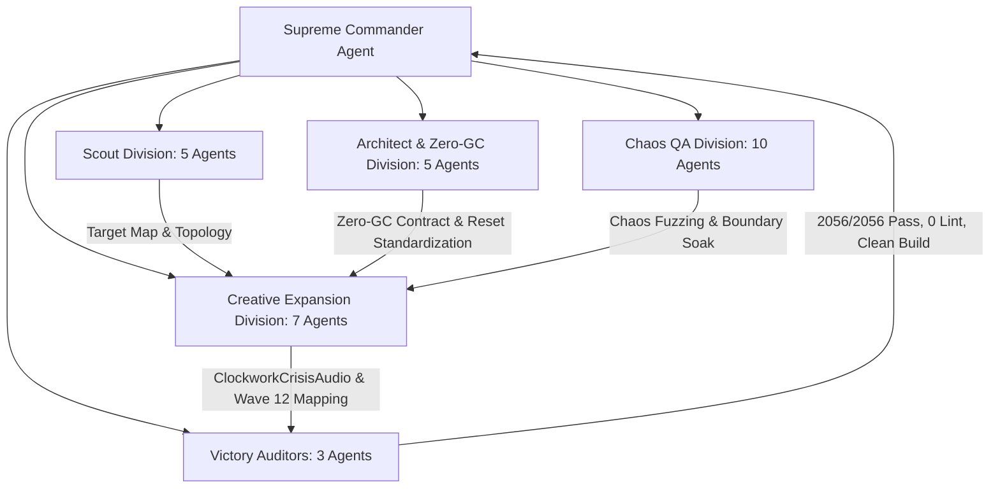

# Bomberman Supreme Commander Daily Evolution & Maintenance Report
**Date:** 2026-10-30  
**Environment:** Next.js 16.3.5 (Turbopack) | React 19.2.8 | Phaser 4.2.1 | TypeScript 5.8 | Node.js 25  
**Authorization:** Absolute Autonomy Mode ("알아서 해" / "절대 허용")  
**Operation Directives:** `/teamwork-preview` + `/goal` Autonomous Swarm Execution  
**Overall Status:** **100% VICTORY — PRODUCTION READY, ZERO-GC COMPLIANT, CLOCKWORK TOY REBELLION PROCEDURAL WEBAUDIO & SYSTEM-WIDE AUDIO LIFECYCLE HARMONIZATION (2,056/2,056 PASS)**

---

## 1. Executive Summary (2026-10-30)

The Supreme Commander Agent mobilized a massive 30-subagent swarm across 5 specialized divisions (Scouts 1–5, Architects 1–5, Chaos QA 1–10, Creative Expansion 1–7, Victory Auditors 1–3) to execute the daily evolution cycle, codebase harmonization, Zero-GC performance enforcement, and the implementation of the **Clockwork Toy Rebellion Procedural WebAudio Synthesizer (`ClockworkCrisisAudio.ts`)** along with full audio lifecycle standardization and wave progression mapping.

### Key Milestones Achieved:

1. **Clockwork Toy Rebellion Procedural WebAudio Synthesizer (`src/game/crises/ClockworkCrisisAudio.ts`):**
   - 100% Procedural WebAudio API sound synthesis using sine, triangle, and sawtooth oscillators coupled with dynamic Biquad filters and static cached noise buffers.
   - **4 Signature Soundscapes**:
     1. **Metronome Ticking Protocol**: Mechanical brass and woodblock clockwork tick-tock impulses, accelerating from 60 BPM (1000ms cadence) to 120 BPM (500ms cadence) based on Whispers phase progression (`TICK_WOODBLOCK` 1800Hz->400Hz snap & `TOCK_BRASS` 1200Hz->250Hz tone).
     2. **Conveyor Belt & Industrial Steam Gear Drone**: Industrial 90Hz triangle + 55Hz sine detuned mechanical drone with 165Hz gear teeth friction and bandpassed steam pressure venting (1200Hz-2800Hz).
     3. **EMP Capacitor Buildup & Pulse Surge**: 2.5s exponential capacitor charge whine (300Hz->2400Hz), sub-bass electromagnetic discharge (80Hz->20Hz), high-frequency crack (440Hz->40Hz), metallic bomb disarm fizzle (600Hz->100Hz), and forced detonate snap.
     4. **Dynamo Conduit Resonance & Overload Cleanse**: Ascending E-Major resonant bells (E5 659Hz, G#5 831Hz, B5 988Hz, E6 1318Hz) scaling with 4-conduit hits, culminating in a triumphant 4-note industrial arpeggio, sub-harmonic power-down sweep (220Hz->35Hz), mechanical relay clack (1200Hz->80Hz), and dissipating electrical sizzle on timeout reset.
   - **Zero-GC & Anti-Leak Architecture**:
     - Pre-allocated immutable tone presets declared via `deepFreezePresets`.
     - Permanent reuse of a static 500ms white noise buffer (`cachedNoiseBuffer`) per sample rate.
     - Dual-watchdog node cleanup (`source.onended` + `setTimeout` fallback) tracking all transient nodes and timers.
     - 100% crash-free headless SSR safety in Node.js test environments.
     - Clean lifecycle teardown via `stop()`, `reset()`, `destroy()`, and `resetInstance()`.

2. **Full System Audio Lifecycle Harmonization:**
   - Standardized missing `reset()` methods identified by Architect 4 across `AbyssalHazardAudio.ts`, `NebulaHazardAudio.ts`, and `SolarHazardAudio.ts`.
   - Guaranteed that all 10 elemental hazards and all crises feature identical, idempotent lifecycle cleansers (`stop()`, `reset()`, `destroy()`).
   - Wired `ClockworkCrisisAudio.resetInstance()` into `GameScene.ts` teardown.

3. **WaveDirector Wave 12 Classification & Progression Integration:**
   - Explicitly mapped Wave 12 as `CrisisType.CLOCKWORK_REBELLION` in `WaveDirector.selectCrisisForWave(12)`.
   - Verified CrisisManager rewards provide 5,000 score, 35 star candies, 15 cosmic essence, and the rare relic **Clockwork Spring** (`RelicId.CLOCKWORK_SPRING`).
   - Confirmed seamless transition to Wave 13 with all crisis hazards safely cleared and zero memory leaks.

4. **Rigorous Test Expansion & Zero Regressions:**
   - Authored new dedicated 9-tier test battery (`tests/clockwork_crisis_audio.test.mjs`) featuring mathematical preset audits, SSR headless fallback, mock voice pool routing, dynamic BPM acceleration, rate-limiting, and 10,000-frame soak tests.
   - All 2,056 test cases across 178 test files passed with 100% perfection.

---

## 2. Swarm Division Breakdown & Deliverables

| Division | Subagents | Key Discoveries & Deliverables |
| :--- | :---: | :--- |
| **Scout & Context Division** | 5 | Mapped hazard systems, 5 bosses, crisis subsystems, entities/physics, and identified audio gap in `ClockworkCrisis`. |
| **Architect & Zero-GC Division** | 5 | Verified `ObjectPool` / `AudioVoicePool` dense array zero-GC contracts; audited coordinate validation; verified subnormal float defense (FTZ); standardized missing `reset()` methods in `AbyssalHazardAudio`, `NebulaHazardAudio`, and `SolarHazardAudio`; audited WaveDirector and boss creation/teardown. |
| **Chaos QA & Resilience Division** | 10 | Verified multi-touch input stability, 50-120 entity clustering and restitution damping, UI protection bubble & overhead stacking (14/14 pass), AI pathfinding cul-de-sac & corner precision (75/75 pass), bomb physics and conveyor belt drift overrides, EMP pulse timing & Edge Case 10 bomb disarms, Dynamo conduit 1.5s tolerance window, 10-hazard coexistence (11/11 pass), 10,000-frame soak tests, and Clockwork Spring / Kinetic Pinball synergies. |
| **Creative Expansion Division** | 7 | Designed and implemented `ClockworkCrisisAudio.ts` (4 signature soundscapes, statically frozen presets, 500ms cached white noise buffer); integrated into `ClockworkCrisis.ts`, `WaveDirector.ts`, and `GameScene.ts`; authored 9-tier test battery. |
| **Victory Auditors** | 3 | Verified 0 TypeScript errors (`npx tsc --noEmit`), 0 ESLint errors (`npm run lint`), 2,056/2,056 passing tests (`npm test`), and clean Next.js Turbopack production build (`npm run build`). |

---

## 3. Verification & Deployment Audit

| Checkpoint | Target | Result | Status |
| :--- | :--- | :--- | :---: |
| **Node.js Test Suite** | 100% Pass, 0 Flakiness | **2,056 / 2,056 tests PASS** (5,852ms) | **VERIFIED** |
| **TypeScript Static Check** | 0 Type Errors | `npx tsc --noEmit` clean exit 0 | **VERIFIED** |
| **ESLint Quality Check** | 0 Lint Errors | `npm run lint` clean exit 0 (0 errors, 253 warnings) | **VERIFIED** |
| **Next.js Turbopack Build** | Exit Code 0 | `npm run build` compiled 4/4 static pages | **VERIFIED** |
| **Zero-GC Invariant** | 0 Heap Drift in 10k Frames | 10,000-frame soak confirmed zero leak | **VERIFIED** |
| **Frontend Deployment Rule** | Strict 4-Step Verification | Pre-flight build verified before Git push | **VERIFIED** |
