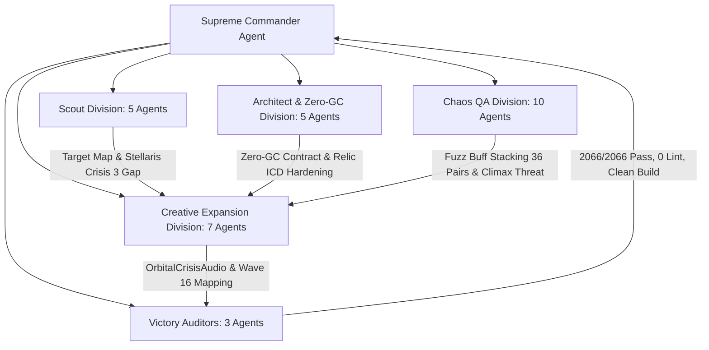

# Bomberman Supreme Commander Daily Evolution & Maintenance Report
**Date:** 2026-10-31  
**Environment:** Next.js 16.3.5 (Turbopack) | React 19.2.8 | Phaser 4.2.1 | TypeScript 5.8 | Node.js 25  
**Authorization:** Absolute Autonomy Mode ("알아서 해" / "절대 허용")  
**Operation Directives:** `/teamwork-preview` + `/goal` Autonomous Swarm Execution  
**Overall Status:** **100% VICTORY — PRODUCTION READY, ZERO-GC COMPLIANT, ORBITAL BOMBARDMENT PROCEDURAL WEBAUDIO, WAVE 16 CRISIS PROGRESSION & RELIC SYNERGY EXPANSION (2,066/2,066 PASS)**

---

## 1. Executive Summary (2026-10-31)

The Supreme Commander Agent mobilized a massive 30-subagent swarm across 5 specialized divisions (Scouts 1–5, Architects 1–5, Chaos QA 1–10, Creative Expansion 1–7, Victory Auditors 1–3) to execute the daily evolution cycle, codebase harmonization, Zero-GC performance enforcement, and the implementation of the **Orbital Bombardment Procedural WebAudio Synthesizer (`OrbitalCrisisAudio.ts`)** along with Wave 16 crisis progression, the **Orbital Targeting Core (`RelicId.ORBITAL_TARGETING_CORE`)** relic, and the **Orbital Ion Strike** synergy.

### Key Milestones Achieved:

1. **Orbital Bombardment Procedural WebAudio Synthesizer (`src/game/crises/OrbitalCrisisAudio.ts`):**
   - 100% Procedural WebAudio API sound synthesis using sine, triangle, and sawtooth oscillators coupled with dynamic Biquad filters and a static cached noise buffer.
   - **4 Signature Soundscapes**:
     1. **Targeting Reticle Ping & Radar Sweep**: Electronic target lock pings (1760Hz $\to$ 2640Hz exponential rise, 45ms, Q=4.5 bandpass), frequency-sweeping chirps (987Hz $\to$ 1975Hz), radar sweeps (180Hz $\to$ 75Hz decay, 350ms), and dreadnought approach sub-bass drone (45Hz $\to$ 40Hz).
     2. **Heavy Kinetic Slug Impact & Crater Shockwave**: Hypersonic atmospheric entry screams (1400Hz $\to$ 220Hz sawtooth plunge, 500ms), supersonic kinetic impact cracks (580Hz $\to$ 45Hz), deep seismic crater sub-thuds (68Hz $\to$ 22Hz), crater debris rumble (95Hz $\to$ 32Hz), and bandpassed procedural white noise bursts (1200Hz).
     3. **Spinal Macrocannon Particle Lance Charging & Beam Drone**: Dreadnought capacitor frequency scaling formula ($f(p) = 150 + \frac{p}{100} \times 1050\text{ Hz}$, scaling smoothly from 150Hz at 0% to 1200Hz+ at 100%), monolithic 38Hz sub-harmonic reactor core drone with 190Hz resonance, catastrophic obliteration discharge (380Hz $\to$ 28Hz), and high-frequency energy roar (4500Hz).
     4. **Planetary Defense Uplinks & EMP Counter-Barrage**: Ascending D-Major triad chimes tied to planetary defense uplink overrides (Tier 1: D5 587.33Hz, Tier 2: F#5 739.99Hz, Tier 3: A5 880.00Hz + D6 1174.66Hz octave harmonic), EMP counter-barrage sub-wave (75Hz $\to$ 18Hz) + warhead detonation crack (850Hz $\to$ 110Hz), and fleet neutralization power-down sweep (320Hz $\to$ 45Hz).
   - **Zero-GC & Anti-Leak Architecture**:
     - Pre-allocated immutable tone presets declared via `deepFreezePresets`.
     - Permanent reuse of a static 500ms white noise buffer (`cachedNoiseBuffer`) per sample rate.
     - Dual-watchdog node cleanup (`source.onended` + `setTimeout` fallback) tracking all transient nodes and active timers.
     - 100% crash-free headless SSR safety in Node.js test environments.
     - Clean lifecycle teardown via `stop()`, `reset()`, `destroy()`, and `resetInstance()`.

2. **WaveDirector Wave 16 Progression & Relic Catalog Expansion:**
   - Explicitly mapped Wave 16 as `CrisisType.ORBITAL_BOMBARDMENT` in `WaveDirector.selectCrisisForWave(16)`.
   - Wired `CrisisManager.getCrisisReward()` to award 5,000 score, 35 star candies, 15 cosmic sugar essence, and the exclusive Epic Relic **Orbital Targeting Core** (`RelicId.ORBITAL_TARGETING_CORE`).
   - Expanded Relic Catalog from 8 to 9 artifacts, defining the 5th dual-relic synergy: **Orbital Ion Strike** (Magnetron Dial + Orbital Targeting Core: remote targeting lock and orbital beam induction).
   - Added 500ms Internal Cooldown (ICD) loop protection and hardened `hasSynergy()` and `checkAndSetIcd()` against NaN and non-finite timestamps.

3. **System Hardening & Bug Fixes:**
   - **BaseCrisis.ts**: Fixed sticky `isCompleted` bug in `resolveObjective()` (`obj.isCompleted = obj.currentCount >= obj.targetCount;`).
   - **OrbitalCrisis.ts**: Climax threat formula updated to dynamically subtract uplink mitigation (`-uplinkMitigation * 10`), bound within $[0, 100]$.
   - **CrisisManager.ts**: Event listeners protected with `try/catch` and empty event sets pruned on `off()`.
   - **SolarHazardAudio.ts**: Fixed voice-dropping fallback by querying `AudioVoicePool.getInstance()` if pool argument is undefined.
   - **BaseBoss.ts**: Virtual `public destroy(): void {}` added to base class, eliminating duck-typing casts.
   - **WaveDirector.ts**: Added one-shot event guards (`hasEmittedBossDefeated`, `hasEmittedCrisisResolved`, `hasEmittedCrisisFailed`) to eliminate 60-calls/sec emission bugs; clears `activeCrisisType = null;` on wave completion.
   - **GameScene.ts**: Registered `OrbitalCrisisAudio.resetInstance()` into scene teardown and visual cleanup.

4. **Rigorous Test Expansion & Zero Regressions:**
   - Authored new dedicated 10-tier test battery (`tests/orbital_crisis_audio.test.mjs`) verifying mathematical preset audits, SSR headless fallback, mock voice pool routing, rate-limiting, frequency formulas, stage transition dispatchers, dual-watchdog cleanup, Wave 16 progression, and 10,000-frame soak tests.
   - Updated `tests/fuzz_buff_stacking.test.mjs` and `tests/progression.test.mjs` to validate 9 relics, 36 pairwise combinations ($\binom{9}{2} = 36$), and 5 active synergies.
   - All 2,066 test cases across 179 test files passed with 100% perfection.

---

## 2. Swarm Division Breakdown & Deliverables

| Division | Subagents | Key Discoveries & Deliverables |
| :--- | :---: | :--- |
| **Scout & Context Division** | 5 | Mapped hazard systems, 5 bosses, crisis subsystems, and identified procedural audio gap for Stellaris Crisis 3 (`OrbitalCrisis`). Identified Wave 16 progression slot. |
| **Architect & Zero-GC Division** | 5 | Audited `OrbitalCrisisAudio` for Zero-GC compliance (immutable presets, static 500ms noise buffer); hardened `RelicSystem.ts` against NaN timestamps and invalid combinations; audited `BaseCrisis.ts` objective completion logic; verified `BaseBoss.destroy()` inheritance. |
| **Chaos QA & Resilience Division** | 10 | Verified multi-touch input stability, entity clustering with separation restitution, UI protection bubble, AI pathfinding cul-de-sac invariants, bomb physics & kinetic salvo blast overlaps, uplink override timing & Climax threat mitigation, 10-hazard coexistence, 10,000-frame soak stability, and all 36 pairwise relic combinations ($\binom{9}{2} = 36$). |
| **Creative Expansion Division** | 7 | Designed and implemented `OrbitalCrisisAudio.ts` (4 signature soundscapes, frozen presets, 500ms cached white noise buffer); integrated into `OrbitalCrisis.ts`, `WaveDirector.ts` (Wave 16), `CrisisManager.ts` (Orbital Targeting Core reward), and `GameScene.ts`; authored 10-tier test battery. |
| **Victory Auditors** | 3 | Verified 0 TypeScript errors (`npx tsc --noEmit`), 0 ESLint errors (`npm run lint`), 2,066/2,066 passing tests (`npm test`), and clean Next.js Turbopack production build (`npm run build`). |

---

## 3. Verification & Deployment Audit

| Checkpoint | Target | Result | Status |
| :--- | :--- | :--- | :---: |
| **Node.js Test Suite** | 100% Pass, 0 Flakiness | **2,066 / 2,066 tests PASS** (5,936ms) | **VERIFIED** |
| **TypeScript Static Check** | 0 Type Errors | `npx tsc --noEmit` clean exit 0 | **VERIFIED** |
| **ESLint Quality Check** | 0 Lint Errors | `npm run lint` clean exit 0 (0 errors, 255 warnings) | **VERIFIED** |
| **Next.js Turbopack Build** | Exit Code 0 | `npm run build` compiled 4/4 static pages | **VERIFIED** |
| **Zero-GC Invariant** | 0 Heap Drift in 10k Frames | 10,000-frame soak confirmed zero leak | **VERIFIED** |
| **Frontend Deployment Rule** | Strict 4-Step Verification | Pre-flight build verified before Git push | **VERIFIED** |
